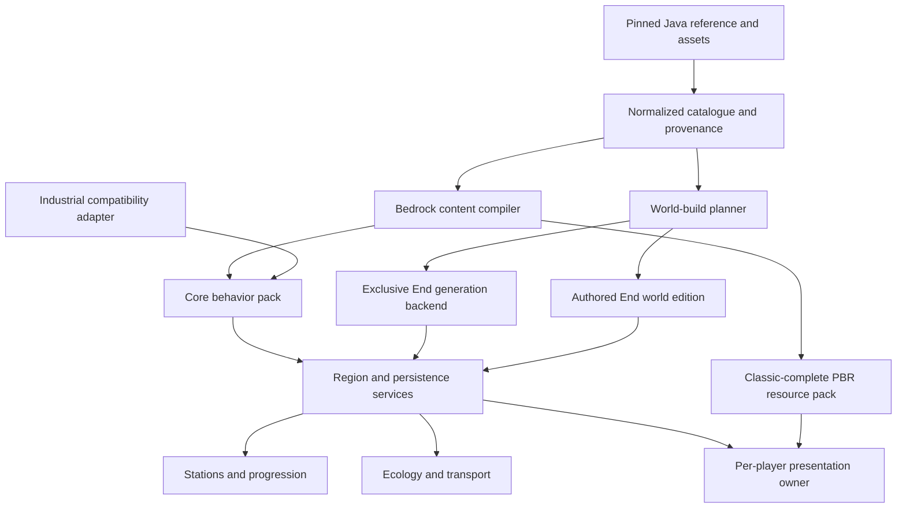
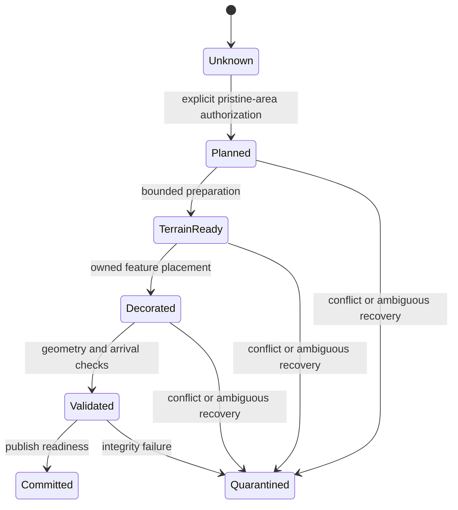

> Initial specification snapshot. Original repository path: `docs/BetterEnd_Bedrock_26.40_Implementation_Plan.md`. Original UTF-8 text SHA-256: `a59f6dda6687a4d4c6b64ef3bc843fdc7419b7db7775b6726f9183278e96a5c6`. Only local document links were adjusted for this copy. The active execution contract is [../execution-contract.md](../execution-contract.md).

# BetterEnd for Bedrock 26.40 — Detailed Implementation Plan

**Target:** Minecraft Bedrock Edition **26.40** content/API baseline, official Bedrock Dedicated Server, and unmodified clients across all supported Bedrock platform families. Newer shipping client/BDS pairs receive separate forward-compatibility qualification; they do not replace 26.40 evidence.  
**Required rendering:** Vibrant Visuals on supported devices; mechanically identical, complete non-VV presentation for other clients on the same server.  
**Research date:** November 2, 2026.  
**Document status:** Researched implementation specification, not an implemented port or a compatibility certification. No Minecraft, BDS, console, or rendering probe was executed while preparing this document.  
**Input:** [BetterEnd_Bedrock_Port_Plan.md](BetterEnd_Bedrock_Port_Plan.md). This document preserves its parity-first product contract but supersedes its **26.60/26.70 assumptions for the 26.40 baseline**. The original is retained as historical research with a pointer to this active contract.

**Navigation**

- [1. Scope](#1-decisions-and-non-negotiable-scope)
- [2. Exact version contract](#2-exact-version-contract-and-corrections-to-the-input-plan)
- [3. Shader/VV support](#3-custom-shaders-and-vibrant-visuals-what-the-port-will-actually-use)
- [4. Upstream inventory and rights](#4-upstream-baseline-inventory-and-rights)
- [5. Native architecture](#5-bedrock-native-architecture-and-repository-shape)
- [6. World generation](#6-world-generation-real-end-explicit-backend-no-silent-approximation)
- [7. Blocks and plants](#7-blocks-models-plants-and-functional-wood-sets)
- [8. Progression and stations](#8-progression-workstations-and-durable-inventory-semantics)
- [9. Wildlife, equipment and travel](#9-wildlife-equipment-transport-and-discovery)
- [10. VV implementation](#10-vibrant-visuals-implementation-specification)
- [11. Capability probes](#11-capability-work-packages-prove-the-risks-before-scaling)
- [12. Dependency backlog](#12-implementation-backlog-and-dependency-plan)
- [13. Milestones](#13-milestones-and-stopgo-criteria)
- [14. Verification and budgets](#14-verification-and-performance-plan)
- [15. Deployment and migration](#15-platform-deployment-and-migration)
- [16. Risks](#16-risk-register-and-release-decisions)
- [17. Execution and acceptance](#17-first-execution-sequence-and-final-acceptance)
- [18. Sources](#18-sources-and-version-evidence-ledger)

## 1. Decisions and non-negotiable scope

1. Reconstruct BetterEnd as a **native Bedrock content system**, not a Java mod loader, Java server bridge, shader-dependent showcase, or rebranded End add-on.
2. Keep the **actual End** as the primary destination. Preserve End entry, the dragon fight, exit portal, gateways, and ordinary survival progression. A custom dimension is a research environment, not an equivalent replacement by default.
3. Preserve the complete upstream survival loop: exploration, natural resources, farming, wildlife, functional construction, processing, infusion, equipment, transport, respawning, and discovery guidance.
4. Port observable behavior, not Java class structure. Use Bedrock JSON/components for engine behavior, TypeScript for missing mechanics, build-time tooling for repetitive conversion, and an authored-world pipeline where runtime generation cannot reproduce the environment safely.
5. Ship a **Classic-complete resource pack enhanced by supported Vibrant Visuals configuration**. VV must never decide collision, recipes, item availability, light levels used by gameplay, damage, spawning, or progression.
6. Treat “custom shaders” precisely: supported PBR/lighting configuration is in scope; arbitrary Java GLSL or patched RenderDragon shader injection is not a required deployment mechanism. Section 3 defines the distinction and the evidence test.
7. Keep industrial balancing and interoperability separate from canonical BetterEnd content. Abyssal Ascent and this port must not simultaneously own End generation.
8. Do not silently omit hard features. A capability that fails becomes a specific architecture decision or a reviewed exception, not an excuse to remove a biome, station, mob, or equipment family.
9. Treat **Windows, Android, iOS/iPadOS, Xbox One/Series, PlayStation 4/5, and Nintendo Switch/Switch 2** as required platform families, not optional desktop-only follow-ups. Platform-specific graphics capability may differ; survival content must not.

### 1.1 Completion and evidence vocabulary

Each catalogue entry receives one of the original plan's statuses: **Native**, **Faithful reimplementation**, **Adapted**, **Unproven**, or **Blocked**. “Blocked” requires documented constraints, a reproducible failed prototype, alternatives, and review. “Adapted” records the exact player-visible difference.

This plan additionally distinguishes:

- **Release evidence:** a dated 26.40-or-earlier source establishes availability.
- **Current documentation:** describes an API today; does not establish availability in 26.40.
- **Design:** an implementation decision proposed here, not an engine guarantee.
- **Probe:** a concrete test still required on the locked binaries and pack stack.

A release is complete only when all required catalogue entries have implemented survival behavior and evidence, or an explicitly approved narrow exception. Compilation, JSON validity, and a decorative demonstration are insufficient.

### 1.2 All-platform custom-server contract

The project's Xbox and Nintendo custom-server connection route is an accepted deployment path. Lack of a console-local `.mcaddon` importer or an arbitrary-address server menu is **not** a reason to exclude a console. Separate connection facilitation from pack execution: a DNS/LAN relay or other established connection helper may get a stock client to BDS without becoming a client mod, renderer patch, or Java-to-Bedrock gameplay bridge.

For each required platform, record four separate results: **connection**, **server resource delivery**, **gameplay/UI**, and **rendering mode**. The server owns behavior and scripts; clients receive the same required resource stack for that deployment. No platform-specific recipe/content fork, manual pack installation, shader injector, or Preview-client requirement is permitted.

All-platform compatibility does not mean VV on every GPU, every edition on an historical release, or every client protocol joining one server binary. Keep the 26.40 reference lane and separately qualify version-matched newer client/BDS deployment lanes where stock consoles require them. An untested platform stays required and unverified, not silently dropped. Validate mouse/keyboard, touch and controller interaction with the same survival mechanics.

## 2. Exact version contract and corrections to the input plan

### 2.1 Production lock

Bedrock **26.40 was released August 4, 2026**. Its creator documentation uses **1.26.40** for engine/content versioning. These are not interchangeable with a pack's own semantic version or a script module version. [R01], [R02], [R04]

| Layer | Initial implementation choice | Evidence and enforcement |
|---|---|---|
| Server and clients | One exact 26.40 reference pair; separately locked newer client/BDS deployment pairs for forward compatibility | Record complete binary/build strings, protocol compatibility and hashes per lane. No console downgrade or cross-version connection is assumed. |
| Pack manifest | Stable manifest format `2`; initial `min_engine_version: [1, 26, 40]` | Verify on the exact client/BDS pair. Do not set `[26, 40, 0]`. [R02], [R04] |
| Content JSON | Per-file schema supported by 26.40 | Do not stamp every file `1.26.40`; texture sets, geometries, feature rules, entities, and recipes have different schemas. |
| `@minecraft/server` | **`2.9.0`** | Explicitly released by 26.40. Pin matching development types and manifest dependency. [R01], [R02] |
| `@minecraft/server-ui` | **`2.1.0`**, only if the feature needs it | Released in 26.30. Do not inherit the input plan's `2.3.0`. [R03] |
| Script language/build | TypeScript, pinned Node LTS and bundler, lockfile | Build to the scripting runtime's supported JavaScript; no Node filesystem/network APIs in game scripts. |
| Experimental script branch | `server` **`2.10.0-beta`**, `server-ui` **`2.2.0-beta`** where explicitly needed | 26.40 experiments, not stable dependencies. The UI beta has a peer dependency on the server beta. [R02] |
| Graphics module | Runtime **`@minecraft/server-graphics: 1.0.0-beta`**, only in the Beta APIs profile | Pin development types to **`1.0.0-beta.1.26.40-stable`**. Per-player controls are present; stable `1.0.0` arrives in 26.50. [R19], [R20], [R26] |
| World base version | Create and record a fresh 26.40 reference world | Some fence/stair neighbor-update behavior depends on world version, not only pack format. Existing worlds require separate migration tests. [R02] |

Create `bedrock/upstream/engine.lock.json` during implementation with server/client builds, platform, binary hashes, API versions, schema sources, experiments, resource/behavior pack UUIDs and versions, world base version, and tool versions. Keep evidence per deployment lane; copying a future documentation example is not an acceptable way to fill the 26.40 lock.

**Availability gate:** obtain legitimate runnable 26.40 server/client installations for baseline verification. For stock consoles that have auto-updated or editions introduced later, use a separately qualified, version-compatible BDS deployment lane rather than requiring a downgrade or removing the platform. Newer-build success never substitutes for the 26.40 reference tests, and newer APIs must not leak into its pack profile.

### 2.2 Changes required relative to the supplied plan

| Input-plan assumption | 26.40 treatment |
|---|---|
| 26.60 production / 26.70 preview | Retain a required 26.40 reference lock and isolated 26.40 experiment profiles. Newer stock-client/BDS deployment lanes require their own evidence; Preview results cannot certify public-console support. |
| `server` 2.11.0 / `server-ui` 2.3.0 | Replace with 2.9.0 / 2.1.0. Explicitly exclude later exports from compilation. |
| Stable per-player graphics module | **Available experimentally on 26.40**, not stable: use `1.0.0-beta` with **Beta APIs**. It does not require Preview clients or automatically require server 2.10.0-beta. Test BDS loading, isolation and cleanup. [R19], [R20], [R36] |
| Expanded custom block entities/containers | 26.40's experimental `minecraft:block_entity` schema exposes dynamic properties only. The custom-block `container` field arrives experimentally in **26.50**, so it is unavailable to this target. Use native inventory carriers instead. [R25], [R26] |
| October Editor Fill Biomes documentation | The 26.40 notes already mention the **Biome Data Assignment Tool** and synchronization; prove that version's End/export behavior instead of importing a later tool's contract. [R02] |
| Native Switch 2 VV as a mandatory 26.40 baseline | The native edition was announced for **October 27**, after 26.40. Qualify it in a newer version-matched deployment lane, while retaining the older Switch edition's non-VV track and the 26.40 reference tests. [R29] |
| World seed access uncertain | Stable 2.9.0 exposes **`world.seed: string`**. Capture it without numeric precision loss, while retaining an explicitly frozen port seed/revision. [R23] |
| Custom dimensions treated as a later capability | Startup-registered **void custom dimensions are stable by 26.30**. Later JSON/default-biome/height controls are a different contract; neither replaces vanilla End progression automatically. [R03], [R23], [R26] |
| Latest stable/preview capability exploration | Continue research, but later-only capabilities cannot satisfy 26.40 acceptance. An experiment supported by 26.40 remains eligible for a deliberate, tested deployment decision. |

### 2.3 Experiment policy

Maintain mutually exclusive build/world profiles:

- `stable-2640`: stable APIs and verified stable content only; default development baseline.
- `experimental-2640`: start with **Beta APIs solely for graphics `1.0.0-beta`**, retaining gameplay `server` 2.9.0 and UI 2.1.0. The graphics package's declared peer range accepts server 2.x. Add Upcoming Creator Features or RenderDragon Features for Creators only for a separately justified probe; graphics beta does not require every experiment. [R20], [R36]
- Forward-compatibility deployment lanes: exact newer public client/BDS builds, with their supported manifest/API profile explicitly locked and tested. Do not assume a version-suffixed beta package remains valid after an engine update. These results certify those builds only, never 26.40 or every future release.

Record each experiment's exact UI name, why it is required, affected content, migration risk, and tested platforms. Avoid enabling every toggle to make errors disappear. Do not promise that experiment-enabled worlds can safely revert. If full parity requires a validated 26.40 experiment, make that a release decision; do not market a reduced stable profile as the complete port.

### 2.4 Verified 26.40 native building blocks

Use the exact **`@minecraft/server@2.9.0` declarations** and Mojang's **`v1.26.40.05` sample snapshot**, commit **`7844835b6baad4c0010f46901a4accf87413a022`**, as implementation inputs. A sample bundle contains experimental schemas too; presence alone does not prove graduation. [R23], [R24]

| Capability | Target contract | Consequence |
|---|---|---|
| World seed | `World.seed: string` | Native seed capture is available; freeze the port seed explicitly and preserve precision. |
| Actual biome query | `Dimension.getBiome`, `containsBiomes` | Use loaded-position queries to validate authored biome data. |
| Seed-based biome search | `Dimension.calculateClosestBiomeFromSeed` | Can disagree with edited biome data; not the port's authored/logical region locator. |
| Loaded-area checks | `Dimension.isChunkLoaded` | Loaded does not imply new, pristine, or safe to overwrite. |
| Bounded loading | `world.tickingAreaManager`, `createTickingArea` | Await loaded/ticking completion, respect observed capacity and release owned areas. |
| Script feature placement | `Dimension.placeFeature`, `placeFeatureRule` | Available on loaded locations; neither takes a TypeScript region callback or arbitrary PRNG seed. |
| Cooperative work | `system.runJob` | Time-sliced preparation, not a chunk-generation interception hook. |
| Custom dimensions | Startup `DimensionRegistry.registerCustomDimension(typeId)` | Stable void generator; keep known IDs rather than assuming target enumeration includes custom dimensions. |
| Native inventories | Block/entity `Container` and `ContainerSlot` operations | Real item custody exists, but no documented multi-container durable transaction primitive. |
| Item metadata | Non-stackable item dynamic properties | Suitable primitive for an Elytra carrier; not transaction labels on arbitrary stackable outputs. |
| Custom components | Startup-registered V2 components, attached directly by namespace | Stable behavior callbacks; persistent per-instance state remains an explicit design responsibility. |
| Respawn/teleport | `Player.setSpawnPoint`, `playerSpawn`, `teleport` / `tryTeleport` | Native primitives exist; End ordering, safe landing and charge semantics still need the gameplay probe. |

The inspected target surface has no general runtime biome setter, no general chunk-generation interception event, and no atomic inventory transaction/save-barrier API. Do not replace these absent contracts with plausible method names. [R23]

## 3. Custom shaders and Vibrant Visuals: what the port will actually use

### 3.1 The term “shader support” has several meanings

| Claimed capability | Meaning for this project | Decision |
|---|---|---|
| A pack changes VV lighting, fog, water, grading, normals, metallic/emissive surfaces | Supported data-driven control of the built-in rendering pipeline | Core visual implementation path. [R14], [R15], [R16] |
| Render controllers, materials, geometry, animation and Molang | Content authoring using supported rendering behavior; not automatically arbitrary GPU-program authoring | Use only validated 26.40 features. |
| Creator experimental point lights or other rendering options | A specific engine experiment, not a general shader loader | Optional enhancement after a 26.40 probe; never required for gameplay. [R02] |
| Java Iris/OptiFine GLSL shaderpack | Java rendering interfaces and conventions | Not directly portable; reconstruct its desired effect using Bedrock mechanisms where appropriate. |
| Legacy Bedrock shader files or modified RenderDragon material binaries/loaders | A renderer/version/platform-specific route that may require modifying the client | Not evidence for server-delivered support on stock Windows/mobile/console clients. |
| Marketplace/community pack advertised as a “shader” | Marketing terminology; may simply configure VV | Inspect required client, installation instructions, files, experiments, license, and exact version before classifying it. |

**Research conclusion:** supported VV customization is real. The reviewed 26.40 release and official VV authoring contracts do **not establish a public arbitrary GLSL/HLSL shader-loading interface for ordinary server-delivered packs**. This is a bounded evidence claim, not a claim that no unofficial shader technique exists. [R01], [R02], [R14], [R15]

There is concrete evidence behind some custom-shader reports: **BetterRenderDragon** advertises shader loading but is an enhancement mod launched through its own launcher, not vanilla pack behavior. Its existence is not denied; it is excluded as a required dependency because this port must work on stock clients through BDS delivery. [R35]

To evaluate any additional shader-support report, require an exact 26.40 sample that loads on an unmodified client, arrives through BDS resource delivery, runs with VV enabled, and survives a second player's independent view. Identify whether it loads executable shader code or only changes supported material/lighting data. A patched Windows/Android demonstration does not certify consoles.

### 3.2 Visual ownership and degradation order

Use one presentation owner per player, independent of generation and gameplay:

1. **Actual custom biome identities**, if the 26.40 authoring/export pipeline proves them, select resource-pack client-biome presets and engine blending.
2. The **26.40 beta per-player graphics adapter** is the selected candidate for logical-region atmospheres where actual identities are unavailable. Its release-matched types include `getPlayerAtmospherics`, `getPlayerColorGrading`, `getPlayerLighting`, and `getPlayerWater`, each taking the underlying `BiomeType` and `Player`; player overrides take precedence over biome overrides. Enable Beta APIs and pass CAP-010 before release. [R19], [R20], [R36]
3. Otherwise use **per-player fog**, localized particles and sounds, region-specific material palettes, and a restrained End-wide VV baseline. This cannot be described as equivalent independent sky, water, grading, and lighting control; record exactly which channels remain shared.

Do not emulate a per-player result by repeatedly editing a global End biome preset. Two simultaneous players in different logical regions are the decisive test. A visual fallback is acceptable only as a reviewed presentation adaptation; it does not reduce environmental or survival content.

Keep graphics imports out of the stable profile's entry bundle. Build mutually exclusive stable and graphics-enabled entry points over the same gameplay code; an `if` after an unsupported static import cannot rescue loading. Do not duplicate gameplay owners across packs. The recommended high-fidelity logical-region profile uses the documented 26.40 graphics beta, while an authored world with proven native biome blending may not need it. No dummy API shims or swallowed initialization errors.

**[INFERENCE] Spatial limit:** per-player overrides can distinguish two players, but do not create new physical biome volumes. A player overlooking two logical regions that share one engine biome may see one water/lighting override across both. Prefer actual stored identities for spatial fidelity; test distant and vertically stacked water before claiming equivalent region-local rendering.

## 4. Upstream baseline, inventory, and rights

### 4.1 Source snapshot

For this plan, `quiqueck/BetterEnd` branch `release/26.3` resolved to:

**`5a25059ef4fd77409024a2919fb0a0098388104f`**, committed October 22, 2026. This is the concrete research baseline, not an assertion that the Java build has been run. [R05]

The pinned `gradle.properties` declares Minecraft Java **26.3**, BetterEnd **26.301.2**, Fabric loader **0.19.5**, Fabric API **0.162.0+26.3**, and BCLib / WorldWeaver / WunderLib **26.301.2**; its release channel is `beta`. Those Java version numbers do not set the Bedrock engine version. [R06]

Before extraction, resolve the dependency artifacts/commits and checksums, build and launch the reference, and capture configuration defaults. Preserve upstream defects as identified reference observations; do not accidentally introduce serverpack balancing while claiming canonical parity.

### 4.2 Required region catalogue

The pinned registry contains these **27 region keys**. A logical region and a stored Bedrock biome remain different concepts. [R07]

| Layer | Required upstream identifiers |
|---|---|
| Main surface | `amber_land`, `blossoming_spires`, `chorus_forest`, `crystal_mountains`, `dragon_graveyards`, `dry_shrubland`, `dust_wastelands`, `foggy_mushroomland`, `glowing_grasslands`, `lantern_woods`, `megalake`, `shadow_forest`, `sulphur_springs`, `umbrella_jungle`, `umbra_valley` |
| Sub-regions | `megalake_grove`, `neon_oasis`, `painted_mountains` |
| Aerial | `ice_starfield`, `flower_islets`, `waterfall_ponds` |
| Cave | `empty_end_cave`, `empty_smaragdant_cave`, `lush_smaragdant_cave`, `empty_aurora_cave`, `lush_aurora_cave`, `jade_cave` |

Extract each region's actual terrain, feature distribution, plants, structures, resources, wildlife, colors, particles, music, and conditions. Do not invent these from the name. Preserve parent/sub-region relationships and cave/aerial precedence.

### 4.3 Required content families

| Family | Inventory and implementation obligation |
|---|---|
| Wildlife | Dragonfly, End Slime, End Fish, Shadow Walker, Cubozoa, Silk Moth, including variants, drops, spawn constraints and interactions. [R08] |
| Woods | Mossy glowshroom, pythadendron, end lotus, lacugrove, dragon tree, tenanea, helix tree, umbrella tree, jellyshroom, lucernia, lucernia jelly. Extract applicable functional variants; do not assume all eleven share exactly the same generated set. [R09] |
| Natural blocks | Terrain/stone sets, ores, crystals, aquatic/wall plants, vines, mushrooms, saplings, crops, light-emitting growths, snow/ice and other registry-derived families. |
| Functional building | Doors, trapdoors, stairs, slabs, fences, gates, walls, ladders, signs, storage, furniture, boats/rafts and other variants actually registered upstream. |
| Processing and rituals | End Stone Smelter, Aeternium Anvil, Infusion Pedestal, Eternal Pedestal, associated recipes and multiblocks. [R10] |
| Transport and recovery | End Portal Block, portal construction/activation, Respawn Obelisk, safe travel and charge semantics. [R10] |
| Ecology | Silk Moth nest/hive, growth, harvest, breeding/habitat and renewable-resource loops. |
| Equipment | Material sets, hammers, tools, weapons, armor, Crystalite effects, armored Elytra and Crystalite Elytra. [R11] |
| Player guidance | Foods, discs/music, translations, tooltips, discovery/progression guidance and the equivalents of applicable advancements. |

### 4.4 Extraction and catalogue pipeline

1. Export effective Java registries and generated data from the pinned build, including entries produced by BCLib/WorldWeaver factories. Source text search alone is not a complete inventory.
2. Normalize blocks/items/entities/recipes/loot/features/structures/regions into versioned records with an explicit `upstream_id -> bedrock_id` map. Use `betterend_bedrock:` as the proposed stable namespace after collision checks.
3. Flatten model parents and texture aliases; preserve tint sources, geometry variants, rotations, animation timing, alpha/culling intent, and item transforms. Report anything that cannot be represented automatically.
4. Export recipe hyperedges: all ingredients, alternatives/tags, catalysts, quantities, workstation, fuel, duration, byproducts, unlock conditions, and reusable tools. Preserve the source of each value.
5. Derive survival-source edges from worldgen, loot, growth, mob drops and transport access. Every required ingredient must be reachable from legitimate initial survival resources.
6. Emit generated pack JSON separately from hand-written runtime code. A regeneration must not overwrite mechanics.
7. Fail builds for missing mappings, unresolved assets, illegal state values, or missing survival routes. An explicit review entry is not a silent drop.

Record at minimum: `source_commit`, `upstream_id`, `bedrock_id`, `category`, `source_paths`, `state_mapping`, `survival_sources`, `implementation_owner`, `capability_dependencies`, `parity_status`, `evidence`, `exception_id`, and `license_record`.

### 4.5 Licensing gate

The repository's code license is MIT, with copyright attribution, but `LICENSE.ASSETS` separately lists `textures/gui/infusion.png`, `icon_updater.png`, and `lang/de_de.json` under **CC BY-NC-SA 4.0**, attributed to **Team BetterX**. Do not label the whole asset collection uniformly MIT. [R12], [R13]

Create `asset-provenance.csv` with source URL/commit, path/hash, author, license, permitted distribution, modifications, attribution text, and replacement status. Audit music, translations, dependent-library resources, fonts and third-party shader-pack references separately. For restricted assets, comply, obtain permission, or make genuinely independent replacements; renaming or recoloring alone does not remove restrictions. Review server monetization and package distribution before publication. Contact upstream about naming/collaboration without misrepresenting MIT as a blanket permission requirement.

## 5. Bedrock-native architecture and repository shape

### 5.1 Layers and ownership



This is a reconstruction pipeline. Java mixins, block entities, AI goals and renderer classes are specifications to analyze, not runtime code to transplant.

### 5.2 Planned layout

The repository is initialized from `BaiTian6641/BetterEnd`, with `origin` pointing to that fork and `upstream` to `quiqueck/BetterEnd`. The working branch is `experimental/bedrock-26.40`, based on `release/26.3` commit `5a25059ef4fd77409024a2919fb0a0098388104f`. Retain the Java `src/` and Gradle tree as source reference; its build does not produce a Bedrock pack.

Place new Bedrock implementation work under **`bedrock/`**, avoiding the Java repository's ignored root `/tools/` directory. The paths below are relative to `bedrock/`, except for project documentation at root `docs/`. They are planned deliverables, not a claim that a runtime scaffold already exists:

```text
upstream/                 Source/engine locks, provenance, captured schemas
catalog/                  Content, state maps, regions, recipes, visual presets
schemas/                  Catalogue and persistence schema definitions
tools/extract/            Java registry/datagen/reference exporters
tools/compile/            Catalogue -> Bedrock definitions and assets
tools/worldbuild/         Deterministic planning, structure/import tooling
tools/validate/           References, graph, schema, archive, license checks
packs/core_bp/            Core definitions and one authoritative runtime bundle
packs/worldgen_bp/        One selected End-generation provider
packs/resources_rp/      Complete Classic assets plus supported PBR/VV data
packs/industrial_bp/      Explicit integrations and server balance overrides
runtime/bootstrap/       Component registration and world-load initialization
runtime/regions/         Layered coordinate lookup and readiness
runtime/persistence/     Versioned stores, bounded indexes, recovery
runtime/generation/      Controlled preparation and resumable jobs
runtime/stations/        Recipes, inventory ownership, transactions
runtime/ecology/          Spawning, plant growth, habitats
runtime/equipment/        Durability, set effects, Elytra adapter
runtime/transport/        Portals, arrivals, obelisk respawn
runtime/presentation/    Fog, audio, particles and optional graphics adapter
runtime/integration/     Validated cross-pack query/adapter boundary
tests/unit/              Determinism, recipe graph, transaction invariants
tests/fixtures/          Reference exports, save/restart fixtures
tests/capability/        Minimal target-engine probe packs/worlds
tests/scenarios/         Repeatable BDS survival/multiplayer scenarios
tests/visual/            Cameras, reference scenes and capture metadata
../docs/                 This plan, later parity/operations/migration evidence
dist/                    Reproducible release artifacts, never hand-edited
```

### 5.3 Runtime rules

- Register components in the Scripting V2 startup lifecycle; access world state only once world loading permits it. Use pinned 2.9.0 declarations to resolve exact privileges and event signatures. The older V2 overview explains the lifecycle but still contains historical experimental wording; the target release notes govern stability. [R02], [R31]
- Use one owner for each mutable subsystem. Inventory, portals, generation, and presentation must not have competing intervals in separate modules.
- Native components handle routine growth/AI/placement where behavior matches. Scripts handle the gaps; do not scan all loaded blocks each tick.
- Use supported event callbacks and bounded jobs, not a fictional chunk-generation interception event, arbitrary thread, or synchronous full-dimension pass.
- Defer mutations out of read-only/before-event contexts where required. Revalidate coordinates, blocks and player state after deferral.
- Store compact indexed state. Reuse coordinate/cache records in hot paths; avoid repeated JSON serialization and entity enumeration each tick.
- Build-only Node/Java tools can read/write files. In-world scripts do not assume filesystem, SQL, HTTP, or access to BDS internals.

### 5.4 Shared contracts

These are **internal interfaces to implement**, not names of existing engine APIs:

| Contract | Required data / invariant |
|---|---|
| Region lookup | Dimension, integer position -> surface/sub-region/cave/aerial IDs, effective region, tags, generation revision, readiness, optional proven engine biome ID. Deterministic across restart. |
| Region plan | Dedicated port seed, bounds, revision, feature anchors, structure ownership, palette/resource rules and protected volumes. |
| Generation status | Unknown, planned, terrain-ready, decorated, validated, committed; plus fault/quarantine. Unknown never means safe to overwrite. |
| Station identity | Dimension + block anchor + unique station generation ID; rebuilding at the same position must not resurrect old transactions. |
| Station transaction | Recipe ID, transaction ID/revision, physical inventory owner, exact input/output receipts, progress/fuel, participant anchors, recovery state. |
| Presentation intent | Player identity, effective region, transition weight, owned fog/audio handles, selected preset and lifecycle epoch. No gameplay authority. |
| Compatibility query | Versioned read-only request/response for region/tags/readiness/material families over a proven cross-pack mechanism. |

Use direct imports only inside the same bundled runtime. Other behavior packs cannot be assumed to import its private TypeScript. Prototype namespaced script-event messages or a build-time adapter; bound message size/rate and validate source/context. External messages must not directly mint items, commit rituals, or set generation readiness.

## 6. World generation: real End, explicit backend, no silent approximation

### 6.1 Four separate responsibilities

Maintain **terrain geometry**, **logical region identity**, **stored engine biome identity**, and **client presentation** separately. A region service returning `umbrella_jungle` does not make `/locate biome`, native biome loot filters, another add-on, or client-biome blending recognize that biome.

Native End feature placement is documented, but the target's biome-replacement record permits **Overworld and Nether, not End**. New surface/subsurface-builder capabilities do not establish an arbitrary End noise provider. The authoring component is `minecraft:replace_biomes`; a reference page titled “Biome Replacement” must not be mistaken for the component name. [R03], [R21], [R22], [R32]

### 6.2 Backend selection

| Backend | Appropriate use | Release condition |
|---|---|---|
| Native End feature rules | Ores, vegetation, crystals, bounded structures and verified surface changes on engine-generated terrain | Correct placement, shared region selection, adequate geometry/distribution and safe boundaries. |
| Controlled procedural preparation | Build terrain/decoration from deterministic plans using supported block/structure operations | Region prepared before player arrival; resumable; explicit ownership; bounded memory/time. Not uncontrolled mutation around explorers. |
| Authored/pregenerated real-End world | High-fidelity terrain and region layout where reusable generation cannot achieve it | Correct conversion, BDS/clients round-trip, survival parity, published finite bounds and tested expansion policy. |
| Separate custom dimension | Disposable capability sandbox | Not the shipping primary location without an explicit reviewed product change. |

**Decision:** use native End features wherever proved, and develop the authored-world proof early, not after months of content conversion. Select the serverpack's primary terrain backend at the capability gate. The reusable add-on and a finite authored-world edition must be labeled honestly; a reduced reusable generator does not satisfy full terrain parity merely because the authored edition exists.

A finite world's boundary is a product-visible tradeoff. Expansion and behavior beyond its bounds require explicit release approval. This plan does not pre-approve replacing infinite exploration with a concealed wall or endless repetition.

### 6.3 Deterministic region model

1. Capture the stable **`world.seed` string** and store `port_seed` explicitly, plus any Java reference seed as a separate field. Default the port seed from the captured world seed only during initialization; thereafter load the frozen value and generation revision rather than silently reseeding an established world. [R23]
2. Keep 64-bit seeds as strings or two integer words at persistence boundaries. Use an exact tested implementation for Java-compatible integer/PRNG arithmetic; never round through a JavaScript `number`.
3. Separate coarse biome assignment from fine terrain, feature, loot and decoration streams. Derive streams from seed, generation revision, dimension, region/feature identity and anchor coordinates so iteration order cannot change results.
4. Choose planning-cell size from the largest feature/structure margins. Record it in the generation revision; do not bake an arbitrary cell size into content identifiers.
5. Evaluate parent/sub-regions and vertical layers consistently. Use floor division at negative coordinates; test origin, boundaries, extreme supported coordinates and overlapping cave/aerial rules.
6. Give cross-border structures one anchor owner and deterministic conflict priority. Evaluate a halo around each cell, but write each owned feature only once.
7. Separate immutable region identity from mutable player terrain. Breaking a signature block must not change biome identity or spawn an entirely new ecosystem.

### 6.4 Native/script agreement is an early hard gate

Feature JSON cannot call the runtime region lookup. Choose one of two proven mechanisms:

- A small deterministic selector expressible in the exact 26.40 feature/Molang environment and TypeScript, tested with identical coordinate vectors; or
- A shared build-time region/placement atlas that generates both native placement definitions and the runtime lookup data for the locked seed/bounds.

Do not assume native random streams, noise functions, floating-point precision, or available seed variables match JavaScript. Compare at least **10,000 fixed vectors**, including negative coordinates and every boundary case; acceptance is **zero region disagreements**. Also compare actual generated placements with the predicted region, not just two copies of one algorithm.

If neither mechanism works, use one controlled generation owner for both terrain and identity. Do not let native placement, mob ecology, and visuals choose different regions independently.

Stable `placeFeature`/`placeFeatureRule` make a third concrete path possible: a single script-owned preparation plan chooses the region and feature family, then uses native feature placement in a controlled loaded area. Their signatures do not accept a custom random seed. Distinguish deterministic ownership/major geometry from native micro-decoration, and compare reversed exploration/restart order before claiming exact output determinism. Feature rules in the same placement pass have no guaranteed order; use explicit composition or separate proven stages instead of filename order. [R23], [R24]

### 6.5 Safe generation and persistence

Persist a region journal with schema/revision, ownership, plan hash, stage checkpoints, completed feature anchors, validation outcome, and error state. The progression is:



Missing metadata is **not** evidence of pristine terrain. New-world generation and explicitly approved preparation volumes are eligible; existing player-built or foreign-pack areas are not. Never regenerate a committed region after pack reload, algorithm update, or a missing decorative block.

Preparation must be idempotent only within owned, unexposed stages. Once exposed to players, use migrations, not reapplication of the terrain recipe. Recover after interruption using stage checkpoints and expected data; quarantine ambiguous regions instead of overwriting them.

Use **`world.tickingAreaManager.createTickingArea`**, await its loaded/ticking completion, validate with **`Dimension.isChunkLoaded`**, and perform bounded work through **`system.runJob`**. Query the manager's capacity and existing usage before allocating; release this pack's temporary areas on completion/failure and reconcile leaked ownership after restart. Capacity exhaustion must cause a safe wait/refusal, not unchecked access. These are stable target primitives, not proof that preparation can outrun arbitrary flight. A missing block is not air, and runtime code must not retain invalid block/entity references across unloads. [R23]

### 6.6 Arrival safety and vanilla End infrastructure

- Reserve the central dragon-fight area, exit fountain, obsidian arrival platform, towers, gateways and their destination/landing volumes while prototyping. Derive protected volumes from reference/world data and test dragon respawn.
- Add upstream central-island content deliberately later; the prototype exclusion is not a permanent omission.
- Do not generate dangerous terrain around a player already arriving through a gateway or flying rapidly. Prefer ahead-of-time prepared corridors/regions and verified safe destinations.
- Define behavior for portals, flight, disconnect/rejoin and respawn at the unprepared boundary. A holding platform or delayed teleport is a visible adaptation requiring review, not invisible full-parity generation.
- Include End cities, ships and vanilla resources in overlap/progression checks. Preserve their access unless the pinned reference explicitly replaces it.

### 6.7 Authored-world pipeline

1. Generate a small pinned Java reference area containing land, water, a cave, a large tree, a structure and a functional container.
2. Export block states, biome volumes, structures, relevant entities and block-entity contents into an intermediate format with checksums. Resolve unmapped blocks before import.
3. Convert orientation, axes, waterlogging/liquid layers, multiblock ownership, collision states and loot/inventory data explicitly. Do not assume a vanilla Java-to-Bedrock converter understands BetterEnd.
4. Import through a verified authoring/structure pipeline into a disposable 26.40 Bedrock world. Use target-compatible `.mcstructure` data: **26.50 introduces structure format v2**, so a later Editor export is not automatically a valid 26.40 artifact. If direct world-database conversion is evaluated, it must use a version-qualified tool on a copy; no live BDS database edits or invented runtime block IDs. [R26]
5. Use the **26.40 Biome Data Assignment Tool** to probe custom End biome assignment. Verify save/reopen, export, BDS load, client sync, visual blending and persistence through restart using actual **`getBiome`** samples, not `calculateClosestBiomeFromSeed`, which can miss authored changes. The documented Editor tool is evidence to test, not proof this whole chain works. [R02], [R23]
6. Compare block-state counts, representative geometry, liquids, container contents, inventories, native End infrastructure and region metadata against the export.
7. Expand only after the small round-trip succeeds. Publish world bounds, seed, revision, map size, expansion procedure, backup policy and out-of-bounds behavior. Freeze already released regions.

## 7. Blocks, models, plants, and functional wood sets

### 7.1 Conversion rules

For every block, define appearance, states, placement, selection/collision, support rules, break speed/tool tier, blast/fire behavior, light, sounds, drops, piston/fluid behavior, interactions, recipes, and survival source.

- Flatten Java model parents into Bedrock geometry; explicitly convert axes, UV rotation, pivots, culling, face visibility and item transforms. A successful file conversion is not a visual/collision test.
- Encode only meaningful state combinations. Estimate permutation counts before generation; split identifiers only with a deliberate stable state map and migration policy.
- Map connection and orientation behavior to native 26.40 traits/components where possible. The target releases vertical `minecraft:multi_block`, sixteen-way placement rotation and relevant rotation support; horizontal multi-block directions remain experimental. [R02]
- Do not combine `minecraft:multi_block` with `minecraft:block_entity`: the target notes list that restriction. Keep a station's authoritative storage anchor separate from purely visual multi-block parts. [R02]
- Cover held, dropped, inventory, item-frame, shelf and placed forms. 26.40 specifically fixes some custom-block MER/emissive display cases; test them rather than assuming all forms are equivalent. [R01], [R02]

### 7.2 Functional acceptance matrix

| Group | Required mechanics and boundary tests |
|---|---|
| Logs/planks and derivatives | Axes, stripping where applicable, correct tools, fire, crafting, drops and textures. |
| Stairs/slabs/walls/fences/gates | Connection geometry, stair corners, upper/lower states, water interaction, adjacent vanilla blocks and update propagation in new/existing worlds. |
| Doors/trapdoors | Placement/support, two-part integrity, opening, obstruction/collision, redstone where upstream applies, explosions and exactly one drop. |
| Ladders | Support, orientation, climbability, breaking support and matching item geometry; not decorative wall textures. |
| Signs | Editable readable text, controller input, front/back/dye/glow behavior where present upstream, storage and break/reload; do not claim custom sign capability from geometry alone. |
| Storage | Real inventory semantics, multiplayer access, hopper behavior where required, item metadata preservation, break/explosion/death and save/load. |
| Furniture/boats/rafts | Actual sitting/riding/placement where applicable, collision, dismount safety, passengers, storage variants and item recovery. |
| Saplings/large vegetation | Soil/light/fluid requirements, natural growth and bone meal where applicable, obstruction, replaceable blocks, tree variants and renewable drops. |
| Vines/wall/aquatic plants | Support and neighbor changes, underwater placement, growth limits, shears/silk-touch, harvest/regrowth and chunk-border behavior. |
| Crystals/lights/translucent blocks | Orientation, loot, actual block light, correct transparency, selection and Classic readability independent of VV emissive maps. |

Prefer real blocks over per-block decorative entities. If sign text, storage or displays require an entity-backed representation, prototype only that family, cap and measure entity cost, preserve selection/collision and recovery, and record the exact deviation. Do not fill every forest with invisible helper entities.

## 8. Progression, workstations, and durable inventory semantics

### 8.1 Recipe and resource graph

Reconstruct Thallasium, Terminite, Aeternium, Crystalite and all other extracted material chains, including intermediate resources, catalysts, fuels, tool requirements, durations and byproducts. Extract actual recipes from the pinned reference rather than inferring them from material names.

Use native recipes for genuinely equivalent crafting, furnace, stonecutting or smithing operations. Do not convert the End Stone Smelter or infusion progression into cheap crafting-table recipes. Evaluate recipe priorities and tag matching against 26.40 behavior. [R02]

Validation must prove:

- Every required input has a survival source reachable before its consumer needs it.
- Workstation construction and activation do not form inaccessible dependency cycles.
- Renewable loops and conversion cycles do not create unintended net resources or bypass stages.
- Loot, farming, mob drops and rare structures provide the intended acquisition routes.
- Canonical and industrial-compatibility graphs are checked separately.

### 8.2 Inventory adapter decision order

**The 26.40 custom-block schema has no native container field.** Its experimental dynamic properties do not supply inventory slots or a screen; custom-block containers arrive experimentally in 26.50. Do not spend the capability phase trying to enable that later field on this target. [R25], [R26]

1. Prototype an **anchored persistent custom-entity inventory** using the target's native inventory component and item custody. Prove its native screen, controller/touch access, hopper insertion/extraction, lifetime, visibility, chunk loading and metadata preservation. A component declaration alone does not prove the complete UI/carrier combination. [R24]
2. Keep a **vanilla-container-backed station** as the conservative functional reference if the custom carrier fails. Any different footprint, screen layout, appearance or automation behavior requires explicit parity review. A carrier changes internal representation, not the recipe.
3. Use supported forms for help, recipe browsing, configuration and explicit actions. Stable UI 2.1.0 does not establish native inventory-slot controls. Native `minecraft:crafting_table` supports shaped/shapeless recipes, not arbitrary smelter/infusion behavior.
4. If neither carrier preserves critical semantics, stop that release gate and present the narrow adaptation for review. Do not assume an invisible entity or global vanilla UI override solves the problem.

Avoid broad `player.json`, vanilla container, or global UI overrides. Never store arbitrary user items as just `{typeId, amount}` JSON; that loses enchantments, names, durability, lore and other metadata. Keep actual `ItemStack` contents in a tested native physical inventory wherever possible.

### 8.3 Station model

| Field group | Required data |
|---|---|
| Identity | Schema version, station type, dimension, anchor, unique generation ID. |
| Ownership | Inventory carrier/anchor identity, role-to-slot map, interacting player, lock epoch. |
| Recipe | Recipe ID and revision, participating pedestal positions, expected ingredients and quantities. |
| Progress | State, elapsed processing ticks, fuel/charge, pause reason, output capacity. |
| Transaction | Monotonic revision, transaction ID, input receipts, pending outputs, commit/recovery receipts. |
| Recovery | Last consistent checkpoint, unresolved action, quarantine reason and evidence. |

Use a server-authoritative state machine: idle, validated, reserved, processing, output-pending, committed; with paused, cancelled and recovery-required branches. The exact input-consumption moment must match the reference mechanic or be explicitly adapted.

For infusion, acquire all participating pedestal locks in deterministic anchor order, then revalidate geometry, inputs and output space. A participant cannot be owned by two rituals. Visual particles/animation reflect state; they never prove completion.

### 8.4 Transaction and interruption policy

1. Validate actor permission, distance, station identity, block arrangement, recipe, inventory revisions and available output space.
2. Record the intended transaction and exact affected slots; reserve access through the adapter's **proven** locking mechanism. An in-memory boolean does not lock a hopper or engine inventory screen.
3. Move/consume the required inputs while recording verifiable receipts. Preserve item metadata and catalyst semantics.
4. Persist progress at meaningful checkpoints; do not rewrite every idle station every tick. Pause correctly on unload according to the reference behavior; do not invent offline catch-up production.
5. Commit into an owned output slot/buffer exactly once under the tested recovery model. Handle a full output inventory without dropping or duplicating items.
6. Release locks and clear only receipts that are no longer needed for recovery.

Keep each short mutation/commit free of `await`, job yields and form callbacks. Use native move/transfer operations for custody changes, handle returned leftovers, and remember that `Container.getItem` returns a copy while a slot API references live storage. Use real escrow if inputs must be reserved against hoppers or already-open screens. Container-open/close and inventory-change after-events are not a universal cancellable item-movement transaction. [R23]

**Durability limit:** Bedrock script properties, block/entity inventories and world saves are not assumed to be one ACID transaction. A journal alone does not prove crash-atomicity. Probe interrupted saves and hard termination as well as normal stop/unload. Reconcile receipts against physical contents; ambiguous recovery must quarantine the transaction for explicit recovery, not mint a second output or silently discard inputs. If the engine cannot provide the required guarantee with an adapter, the failure is a release blocker for that design.

Test simultaneous activation, rapid repeated interaction, hopper insertion/extraction, break/explosion of any participant, inventory full, player disconnect/death, chunk unload, normal restart, abrupt termination, and a partial save. Check conservation of input/output quantities and metadata, not merely that the station still exists.

### 8.5 Persistence implementation

Use versioned, bounded world/entity/item properties supported by the locked profile; keep native inventories authoritative. Shard indexes by region, load on demand, cache with bounded eviction, and write only dirty records. Keep old schema readers only during an explicit migration; remove obsolete paths after cutover.

Item dynamic properties are restricted to **non-stackable items** in the target declarations; keep transaction receipts on world/entity state, not arbitrary stackable outputs. Persist during operation: the shutdown callback is restricted and does not provide a guaranteed writable final flush or cover abrupt termination. Account for replacement/support-loss/permutation paths that are not universal block-break callbacks, and never create a second inventory merely because the original carrier is unloaded. [R23]

Experimental 26.40 block dynamic properties have a **1 KB limit per block per pack**, are keyed by manifest UUID, and changed serialization in a way that loses older saved properties. They are not an unbounded station database and cannot be casually adopted in an existing world. Stable pack UUIDs and full-world backups are mandatory. [R02]

## 9. Wildlife, equipment, transport, and discovery

### 9.1 Wildlife and ecology

Implement all six registered families using native movement, navigation, animation, targeting and lifecycle components where possible. Extract and compare health, hitbox, hostility, attacks, drops, habitat, variants, spawn limits, despawning, breeding and special interactions. Pinned source spawn rules are starting evidence, not permission to approximate every mob with one shared AI. [R08]

Use the region service for logical-region eligibility. Native biome filters are valid only when actual stored identities/tags are established. A managed spawn scheduler must count existing populations, validate support/water/space, respect peaceful difficulty and loaded areas, and avoid repopulating a farm every border crossing. Prefer bounded region sampling over repeated global entity scans.

Implement Silk Moth nest/hive production and habitat behavior as part of renewable progression. Preserve plant growth and harvesting conditions; test multiplayer farms, chunk edges, removal of habitat and long-running population stability.

26.40 tightens numerous entity schemas and changes projectile/knockback contracts. Compile against the correct format and test ranged attacks, float-wander ranges, on-kill events and projectile bounce rules instead of copying obsolete examples. [R01], [R02]

### 9.2 Equipment and genuine gliding

Implement tools, hammers, weapons and armor with native components plus small supplemental scripts. Verify mining tiers/speed, durability, repair ingredients, enchantments, attack behavior, set effects, damage ordering, knockback, fire resistance, attachment rendering, death drops, storage and cross-player transfer.

Armored and Crystalite Elytra are required content, not optional cosmetics. [R11]

- The inspected 26.40 item-component schema has **no custom glider component**, and stable player gliding is observable rather than exposed as a general start-gliding setter. A mob glide component is not a player-equipment solution. [R23], [R33]
- Prototype a **vanilla Elytra carrier** with non-stackable-item dynamic properties and supplemental effects. This is the selected native-flight candidate, not a proved full-parity result. Verify that crafting, equipping, transfer, anvil/repair, enchanting, durability, death, storage and reconnect retain its identity.
- Do not use a display name as authoritative identity. Check whether carrier metadata affects stacking/recipes or is lost through vanilla operations.
- Preserve real Elytra physics and rocket behavior. Repeated player teleportation is not a faithful gliding implementation.
- Measure armor/damage semantics against Java rather than assuming Bedrock armor slots expose Java toughness or identical reduction formulas. Avoid recursive damage handlers and double application with industrial armor effects.
- If appearance or item identity cannot coexist with native flight, document that exact difference and require review; do not remove flight or the item family.

### 9.3 Portals and Respawn Obelisk

Represent portal activation and travel as authoritative transactions with source, destination, actor, activation resource/charge, pending arrival and completion state. Preserve the pinned reference's construction, destination selection, reuse and return behavior.

Before consuming a travel resource, validate dimension, prepared-region readiness, destination support, collision/headroom, obstruction and void safety. Handle unavailable destinations without item loss or portal loops. Revalidate after loading/teleport, bound repeated arrivals and preserve vanilla dragon/exit/gateway behavior.

Probe **`Player.setSpawnPoint`** in the End before selecting the Respawn Obelisk representation. A dimension-bearing signature does not prove correct death-screen or respawn behavior. If a `playerSpawn`-based post-respawn teleport is required, distinguish death from `initialSpawn`/reconnect, preserve Hardcore rules, and specify safe interim location, event ordering, charges, destroyed/obstructed obelisks, disconnect during respawn, inventory rules, cross-dimension deaths and other respawn add-ons. Record any visible adaptation. [R23]

### 9.4 Audio, translations, and progression guidance

Provide all legally usable sound families, ambience, music/discs, localized names, tooltips and controller-readable guidance. Rebuild applicable advancement-style discovery as a Bedrock-native progression journal or notifications without making a compulsory menu the exploration loop.

Own one intended regional music/ambience state per player. Apply hysteresis and minimum residency so border oscillation does not restart tracks. Stable 26.40 exposes `SoundInstance.stop`; advanced fade/seek/loop controls in the 26.40 notes are beta and must not leak into the stable build. [R02]

Audio, cosmetics and help can degrade with graphics/device capability; recipes, obtainable items and progression cannot.

## 10. Vibrant Visuals implementation specification

### 10.1 Resource-pack packaging

Start with **one universal resource pack** containing complete albedo/geometry/audio plus PBR texture sets and supported VV settings. Declare `capabilities: ["pbr"]`. The official VV pack guide requires an engine version of at least 1.21.120; the chosen 1.26.40 minimum exceeds that requirement. Do not require the RTX renderer or a manual client installation. [R15]

This choice avoids a subtle overlay defect: **texture-set images must exist in the same resource pack as their texture-set definition**, and a higher-priority texture set replaces rather than merges with a lower one. If a VV overlay becomes necessary, duplicate its required albedo/maps into that overlay and test the resulting stack. Merely placing texture-set JSON in a second pack that refers to images in the base pack is not valid. [R16]

Keep resource ownership explicit. Limit vanilla client-biome overrides to the End definitions needed by the selected presentation strategy; do not recolor the Overworld or another add-on's dimension incidentally.

### 10.2 Material authoring

| Asset class | Material treatment | Acceptance |
|---|---|---|
| Bark, terrain and rough stone | Predominantly nonmetal, rough, restrained normal/height detail | Retains pixel-art palette and shape in both modes; no wet-plastic appearance. |
| Leaves, membranes and soft growth | Deliberate alpha/cutout, optional nonmetal subsurface maps | Readable silhouette, no sorting disaster or extreme overdraw in dense forests. |
| Metals and processed resources | Authored metalness/roughness, no baked highlight mistaken for a light source | Material distinction survives End lighting and handheld/inventory views. |
| Emissive plants and crystals | Emissive masks limited to intended pixels; gameplay emission defined separately | No entire-texture glow, unreadable bloom, altered spawn rules or accidental light-level change. |
| Transparent crystals | Tested translucency, normals and emissive detail within VV limitations | Do not promise water-style SSR/refraction on arbitrary transparent blocks. |
| Wildlife, armor and items | Dedicated texture sets/attachables where supported | Correct placed/held/dropped/frame/shelf/third-person variants; no actor height-map corruption. |
| Water and aquatic regions | Native water plus supported appearance settings | Swimming, collision, drowning and fluid behavior remain native and identical in Classic. |

Texture-set invariants: [R16]

- MER uses **R = metalness, G = emissive, B = roughness**.
- MERS additionally uses **A = subsurface**, not surface transparency. Transparency remains in the color texture's alpha channel.
- Use either `metalness_emissive_roughness` or `metalness_emissive_roughness_subsurface`, never both.
- Use either `normal` or `heightmap`, never both in one texture set.
- Texture-based items use normals rather than height maps. Verify geometry-rendered cases separately.
- Do not blindly import LabPBR/Java shaderpack channel conventions. Reauthor/repack with explicit channel mappings and legal provenance.
- Respect the documented metalness/subsurface competition; do not make leaves simultaneously metal and subsurface.
- Use image-based MERS for texture variations where uniform values are unsupported.
- Validate layer dimensions/channels and all same-pack paths. Keep original texture resolution unless a reviewed asset decision changes it.

Use a material sample board before bulk conversion: rough stone, bark, leaf, translucent membrane, metal, emissive plant, crystal, water, one actor and one held item. Test all display forms affected by the 26.40 graphical fixes. [R01], [R02]

### 10.3 End atmosphere and sky reconstruction

Author namespaced presets in the supported `atmospherics/`, `color_grading/`, `lighting/`, `water/`, `local_lighting/` and client-biome resources. **VV cubemap customization is documented as Overworld-only; the End retains its built-in cubemap.** Do not plan an End skybox replacement through the Overworld cubemap configuration. Maintain per-channel capability flags and an explicit sky-rendering exception candidate. [R28]

The built-in per-biome VV settings take precedence over global pack settings. Changing only `lighting/global.json` will not necessarily change the End. Bind the intended preset through the actual End client-biome definition or the proven graphics adapter. The official client-biome example uses `the_end`; do not assume every resource identifier is spelled like the runtime dimension ID. [R17], [R18]

Reconstruct BetterEnd's appearance through:

- Palette, terrain silhouette and vegetation density first.
- Region fog distance/color, underwater visibility, atmosphere and color grading.
- Supported atmosphere and the **End flash** lighting controls, rather than assuming Overworld sun/moon or custom cubemap parameters define End behavior. Flash placement/timing is not exposed merely by color/illuminance controls.
- **Nonexperimental static colored block lighting**, available by 26.10, with a small shared palette. Dynamic point lights require the separate **RenderDragon Features for Creators** experiment and remain optional. [R34], [R02]
- Sparse localized particles, animations and legally usable ambience.

The lighting schema documents End flash control from 1.21.80 and ambient/sky keyframing from 1.26.0. These are useful native controls, but not a replacement for an arbitrary Java sky renderer. [R17]

Maintain the same tone-mapping operator, orbital offset, caustics parameters and wave-enabled setting across presets where the official blending model cannot interpolate them. Engine water blending is based on geometry location, unlike several camera-based atmosphere settings; test viewing two lakes from one cliff as well as standing inside each region. [R18]

Water waves affect appearance, not fluid geometry. Test same-biome distant water and vertical cave/aerial boundaries separately; a pre-target vertical-blending fix explicitly excluded water, and this research did not establish a later pre-26.40 fix. Successful API setters alone do not prove a setting changes the End's fixed sky or every visible water volume. [R38], [R39]

Before emitting graphics JSON, enforce these historical schema corrections rather than copying a rolling tutorial:

| Surface | 26.40-safe authoring rule |
|---|---|
| Atmosphere/water files | Use the applicable **1.26.20** schema with its required settings root and `description`; validate against the target samples. [R37] |
| Water sampling | Do not emit removed `sampleWidth`, even if a current tutorial still includes it. [R38] |
| Local lighting | Use `local_lighting/local_lighting.json`, not the removed `point_lights/global.json`. [R34] |
| Material ambient occlusion | Use the target numeric `ambient_occlusion` contract, **0–10**, not an obsolete Boolean example. [R37] |
| Volumetric fog | Use the dedicated VV fog contract; older generic “RTX-only” wording is not the VV rule. VV absorption uses luminance rather than full independently tinted RGB absorption. [R40] |

VV uses image-based and screen-space reflections. Off-screen mirrors and first-person mirror effects are not guaranteed, and transparent geometry other than water does not receive SSR under the documented pipeline. Document the lost effect narrowly; retain the crystal content and art direction. [R17]

### 10.4 Per-player presentation lifecycle

The region service publishes presentation intent. Its adapter must:

1. Resolve the dominant surface/cave/aerial region and transition weights; apply border hysteresis.
2. Change only owned settings/handles and only when needed. Prefer engine blending for true biome identities.
3. Reset only owned properties using the actual target methods, such as `resetSkyHorizonColor()`, `resetAmbientColor()`, `resetFlashIlluminance()` and `resetCDOM()`. There is no assumed universal `reset()`. Probe whether each reset restores resource-pack settings or the desired effective biome baseline, including another presentation owner's precedence. [R19]
4. Reconcile on join, reconnect, dimension change, death/respawn and script restart. Test client resource reload and switching graphics modes as supported client actions.
5. Remove only this pack's named fog/audio overrides on exit. Fog-stack entries persist through saves; reconcile stale BetterEnd IDs at join/startup instead of pushing duplicates or removing another add-on's IDs.
6. Keep two players in different regions independent, including when both are stored as the same underlying End biome.

Use a unique named fog-stack entry per ownership purpose. Probe the 26.40 `/fog` command path and its VV effect rather than assuming legacy distance fog changes atmosphere scattering. `Player.fogSettings` appears in the 26.40 beta changes; it is not a stable 2.9.0 shortcut. [R01], [R27]

Never toggle the player's graphics mode, assume a supported device is running VV, or make gameplay depend on detecting that mode. Classic users must see every relevant object and hazard with base textures.

### 10.5 Visual reference and review

Capture two separate references:

- **Canonical:** pinned Java BetterEnd without an arbitrary third-party shaderpack, compared to Bedrock Classic.
- **Enhanced:** an explicitly selected visual-art reference, compared to Bedrock VV. Any shaderpack used as inspiration needs its own version/license record and is not automatically BetterEnd's canonical appearance.

Store camera position/orientation, FOV, resolution, scene layout, seed/revision, time/weather where meaningful, graphics settings, pack order, client/GPU and capture name. Review silhouettes, palette, transparency, fog, water, crystals, animation, exposure and survival readability. Do not use bitwise image equality across different renderers.

### 10.6 Cross-platform VV compatibility contract

Vibrant Visuals is a supported presentation track, not an entry requirement. The same deployment must accept a non-VV Switch/client and a VV-capable client simultaneously with identical blocks, items, entities, recipes, collisions, actual light levels and progression.

| Rendering case | Required result |
|---|---|
| Non-VV / Classic or the edition's supported non-VV mode | Complete readable base textures, geometry, water, signs, UI, hazards and ambience. PBR data must not make the pack unloadable or turn survival content invisible. |
| Stable native VV resources | Valid PBR/MER/MERS, supported per-biome lighting/water/fog and all display forms. No RTX hardware, graphics script module or RenderDragon creator experiment is needed merely for the material track. |
| Enhanced per-player VV | Enable only the server/world profile whose graphics module is supported by that engine. On 26.40 this is `1.0.0-beta` with Beta APIs; retain a real non-VV client in the test. A client without VV must still join, interact and progress normally. |
| VV low/high quality settings exposed by the client | Terrain silhouettes, resource identification, interaction and hazards remain readable; reduce cosmetic load rather than content. Measure each device rather than promise a uniform frame rate. |
| Mode switching, reconnect and suspend/resume | No gameplay-state reset, inventory loss, stuck fog/music, missing materials or leaked per-player overrides. Test switches only where the client exposes them. |
| Split-screen and low-capability devices | Use the mode supported by that edition; gameplay and controller interaction remain complete without VV. |
| Industrial/add-on resource stack | Limit visual ownership to BetterEnd assets and intended End settings, declare pack order, and verify VV remains available with the complete required stack. Do not claim compatibility with every arbitrary third-party renderer/UI replacement. |

Choose the server/world profile once per deployment, not a different gameplay pack per client platform. Do not select or enforce the player's graphics mode. If an optional presentation feature is incompatible, use the complete supported presentation path and record its visual difference; do not suppress a broken core script, drop gameplay families, or require a modified client.

For newer deployment lanes, validate the actual graphics module and manifest dependency before bundling that adapter. The older suffixed beta types are not a promise of forward binary compatibility. Keep target-specific packaging explicit, with the same canonical catalogue and gameplay contracts, rather than speculative runtime imports.

## 11. Capability work packages: prove the risks before scaling

Every probe uses the same evidence envelope: ID, hypothesis, build/API versions, exact experiments, pack hashes/order, world seed/base version, platform, steps, expected result, content log, captures/state evidence, actual outcome, decision and owner. Initial status for every row is **not run**.

| ID | Minimal experiment | Passing evidence / decision |
|---|---|---|
| CAP-001 | Start exact 26.40 BDS with the stable manifest and join from the target client set. | Script modules resolve, packs download from an empty cache, no unexplained content errors; record platform/version availability failures separately. |
| CAP-002 | Place one distinctive feature in untouched outer End terrain, with a protected central test region. | Deterministic eligible placement, no protected-area overwrite, no unwanted Overworld/Nether placement. |
| CAP-003 | Run the shared selector against fixed vectors and compare actual native placements. | Zero region disagreements; choose native-compatible selector, compiled atlas, or a single controlled generation owner. |
| CAP-004 | Attempt a custom End biome definition/assignment using target-native generation and the target Editor route separately. | Real stored identity, query behavior, client preset selection and export/reopen survive; or record logical-only scope precisely. |
| CAP-005 | Import a small Java reference area into a disposable Bedrock End world. | State/orientation/liquid/inventory/structure preservation and correct BDS reopening; choose authored-world tooling only after round-trip evidence. |
| CAP-006 | Build one persistent station using the custom-entity inventory candidate and vanilla-container reference. | Native item movement, controller UI, metadata preservation, unload/break recovery and automation are verified; no dependency on the later custom-block container field. |
| CAP-007 | Execute one infusion recipe with competing players/hoppers and interrupt each transaction stage. | Conservation and no duplicate output; ambiguous hard-crash recovery is explicit, not hidden. |
| CAP-008 | Create and transfer both Elytra variants through equip, flight, rockets, repair, death and containers. | Genuine gliding plus durable identity/effects; list any visual/repair/armor deviation. |
| CAP-009 | Run the material board and representative forest/crystal/water scenes with simultaneous non-VV and VV clients using the same required pack stack; exercise available quality settings and mode changes. | Complete base visuals and active PBR where supported, correct item/display/actor forms, identical gameplay and no client-specific loading failure. |
| CAP-010 | Load graphics `1.0.0-beta` with server 2.9.0 in 26.40 worlds with Beta APIs off/on; then apply distinct `getPlayer*` settings to two players sharing one stored End biome. | Expected profile loading, no Preview-client requirement, independent applicable channels and property-reset lifecycle; explicitly test fixed End sky, two distant lakes and vertically stacked water rather than assuming spatial equivalence. |
| CAP-011 | Exercise owned `/fog` entries and audio through border crossing, dimension change, reconnect and respawn. | Correct per-player fallback and cleanup without removing another pack's settings; record channels not controlled. |
| CAP-012 | Place representative door, sign, connected stair/fence, storage, boat/raft and multi-block plant. | Functional behavior on controller and multiplayer, not only correct appearance; quantify carrier/entity costs. |
| CAP-013 | Test portal activation and charged obelisk across End deaths, blocked/unloaded exits and destroyed anchors. | Safe arrivals, correct charge/resource semantics, no loops or loss, verified respawn ordering. |
| CAP-014 | Two players approach one unprepared region; fly/portal across a boundary; terminate preparation and resume. | Unique ownership, no player exposure to unsafe work, preserved builds and deterministic resumption. |
| CAP-015 | On Windows, Android, iOS/iPadOS, Xbox, PlayStation and Nintendo, test the documented custom-server route, clean-cache pack delivery, interruption/rejection, reconnect and updates on each declared deployment lane. | Connection, resource delivery, gameplay/UI and rendering results are recorded separately; console local import is not required, and no platform is certified from another platform's result. |
| CAP-016 | Compare a valid native VV configuration change with any proposed executable-shader replacement on clean clients. | Establish whether the proposed files actually load and affect the image with VV enabled; a required custom launcher, DLL injection or APK modification fails the stock-client contract. |
| CAP-017 | Qualify separately locked newer public client/BDS pairs for current consoles and native Switch 2, using the 26.40-compatible content catalogue and the engine's explicit graphics adapter profile. | Version-matched multiplayer, save/pack update and mixed VV/non-VV tests pass on those builds; 26.40 reference tests remain independent and mandatory. |

Do not use a later version's successful probe to close a **26.40 baseline** result. CAP-015 and CAP-017 additionally record results for each named newer deployment lane, not for every future version. A failed probe must state whether it disproves the whole capability or only the chosen representation.

## 12. Implementation backlog and dependency plan

Roles below identify workstream ownership, not staffing estimates: **source/tooling**, **engine/worldgen**, **gameplay**, **art/rendering**, and **integration/QA**. One integration owner controls schema changes, pack manifests and release gates.

### 12.1 Foundation and capabilities

| ID | Owner | Dependencies | Deliverable and completion criterion |
|---|---|---|---|
| FND-001 | Integration/QA | None | Obtain/pin the 26.40 reference engine and native samples/schemas; map every required platform to an exact baseline or newer deployment lane without conflating their evidence. |
| SRC-001 | Source/tooling | None | Pin Java/dependency builds, launch reference, extract configuration and licenses; reproducible source/provenance lock. |
| SRC-002 | Source/tooling | SRC-001 | Complete registry/datagen export and normalized schema; all entries classified, no silently missing factories/recipes/assets. |
| FND-002 | Source/tooling | FND-001, SRC-002 | Deterministic generator/bundler/validator and stable UUID/namespace allocation; a small generated pack loads cleanly. |
| CAP-A | Engine/worldgen | FND-001 | Execute CAP-002 through CAP-005 and CAP-014; select terrain/identity backend with recorded boundaries. |
| CAP-B | Gameplay | FND-001 | Execute CAP-006 through CAP-008, CAP-012 and CAP-013; decide inventory, gliding and respawn representations. |
| CAP-C | Art/rendering | FND-001 | Execute CAP-009 through CAP-011, evaluate CAP-016, and coordinate CAP-015/CAP-017; lock same-server VV/non-VV behavior, graphics profiles and visual adaptations. |
| ARC-001 | Integration owner | CAP-A, CAP-B, CAP-C, SRC-002 | Record architecture/experiment decisions and unresolved hard blockers; authorize bulk conversion only for proven contracts. |

### 12.2 Environment and content

| ID | Owner | Dependencies | Deliverable and completion criterion |
|---|---|---|---|
| REG-001 | Engine/worldgen | ARC-001 | Shared layered region service, seed/revision model and golden vectors; deterministic identity and integration query contract. |
| GEN-001 | Engine/worldgen | REG-001 | Protected-End planning, ownership journal and bounded preparation; interruption/overlap/old-world safety scenarios pass. |
| GEN-002 | Engine/worldgen | GEN-001 | Selected native/authored backend produces three contrasting surface regions and one cave, with safe travel and resource distribution. |
| BLK-001 | Source/tooling + art | FND-002, ARC-001 | Terrain/wood/plant model and state compiler; representative functional fixtures pass before full catalogue emission. |
| ECO-001 | Gameplay | REG-001, BLK-001 | All six mob families and region-aware ecology; behavior/drop/habitat fixtures and controlled population soak. |
| FARM-001 | Gameplay | BLK-001, ECO-001 | All growth/harvest/nest/hive loops; renewable survival routes match the extracted graph. |
| GEN-003 | Engine/worldgen + art | GEN-002, BLK-001 | All 27 regions including sub-regions/caves/aerial forms, associated structures and natural materials; encounter evidence per entry. |
| BLK-002 | Gameplay + art | BLK-001, CAP-B | Complete applicable wood/stone functional variants, storage/signs/furniture/boats; no decorative stand-ins for required functions. |

### 12.3 Survival systems and presentation

| ID | Owner | Dependencies | Deliverable and completion criterion |
|---|---|---|---|
| INV-001 | Gameplay | CAP-B, ARC-001 | Inventory adapter and versioned persistence, station identity, bounded indexes and explicit migration/recovery policy. |
| STA-001 | Gameplay | INV-001, SRC-002 | End Stone Smelter and Aeternium Anvil retain recipes/costs/fuel/timing; concurrent access and output-full tests. |
| STA-002 | Gameplay | INV-001, SRC-002 | Infusion/Eternal Pedestal transactions and multiblocks; concurrent/interrupted ritual scenarios pass. |
| EQP-001 | Gameplay | CAP-008, STA-001, STA-002 | All tools/armor/weapons/hammers/Elytra and effects; damage, repair, durability, transfer and death behavior verified. |
| TRV-001 | Gameplay | CAP-013, GEN-001, INV-001 | Portals, safe landings and Respawn Obelisk; native End progression and failure recovery preserved. |
| PROG-001 | Source/tooling + QA | SRC-002, GEN-003, FARM-001, STA-001, STA-002, EQP-001, TRV-001 | Full recipe/source graph and survival playthrough reach all non-exempt content without creative substitutes. |
| VIS-001 | Art/rendering | CAP-C, BLK-001 | Production material compiler, Classic albedo, sample board and PBR maps; valid same-pack texture references. |
| VIS-002 | Art/rendering | REG-001, VIS-001 | All region presets, lifecycle-safe fog/audio/graphics adapter and transitions; two-player isolation. |
| VIS-003 | Art/rendering + QA | GEN-003, ECO-001, EQP-001, VIS-002 | Complete visual/audio/localization coverage and paired reference review; no progression dependent on VV. |

### 12.4 Integration and release

| ID | Owner | Dependencies | Deliverable and completion criterion |
|---|---|---|---|
| INT-001 | Integration | PROG-001, BLK-002, VIS-003 | Versioned industrial adapters and explicit ownership of fog/music/respawn/damage/recipes; no canonical balance substitutions. |
| PERF-001 | Integration/QA | GEN-003, PROG-001, VIS-003, INT-001 | Standalone/full-stack profiling, server and actual-device budgets agreed from measurements, bounded memory/entity/queue growth. |
| OPS-001 | Integration/QA | INT-001, CAP-015, CAP-017 | Rehearse console/custom-server access, clean install/update, interrupted resources, backup restore, migration and rollback on all declared deployment lanes. |
| REL-001 | Integration owner | PROG-001, BLK-002, VIS-003, PERF-001, OPS-001 | Release manifest, verified parity/exception ledger, rights/attribution, hardware evidence, operations instructions and approved distribution. |

After the shared baseline is locked, worldgen, gameplay capability probes, and art/rendering probes can proceed independently. Do not parallelize conflicting edits to shared schemas or perform full content production before the relevant capability path is proved.

## 13. Milestones and stop/go criteria

| Milestone | Included work | Required gate |
|---|---|---|
| M0 — Locked baseline and capability decisions | FND/SRC/CAP/ARC work | Exact 26.40 compatibility established; generation/identity, inventory, gliding, rendering and delivery choices have evidence or explicit blockers. No assumed later APIs. |
| M1 — Survival vertical slice | Umbrella Jungle, Crystal Mountains, Shadow Forest, one source-derived cave; representative tree/resource/wildlife; working infusion | A survival player enters the real End, explores, obtains inputs and completes the ritual; paired Classic/VV clients work; restart/concurrency/arrival safety demonstrated. |
| M2 — Complete environments | Remaining regions, structures, materials, wildlife and farms | Every required environment and natural content entry has encounter evidence; no repetitive placeholder island catalogue sold as terrain parity. |
| M3 — Complete progression | Workstations, equipment, building variants, transport, respawn and guidance | All non-exempt recipes/resources/items reachable; inventories conserve items through supported interruption scenarios. |
| M4 — Visual/audio completion | Materials, skies/fog/presets, animations, audio, localization | Paired reference review, no cross-player setting leakage, no missing texture or Classic-only gameplay failure. |
| M5 — Full-stack release rehearsal | Industrial adapters, performance, all-platform delivery/input, operations/migration | Every required platform family and declared build lane has connection/resource/gameplay/rendering evidence; mixed VV/non-VV coexistence, reproducible artifacts, backups, rollback, approved exceptions and licensing. |

The vertical slice is a validation milestone, not a permitted final scope reduction. All 27 regions and all extracted survival content remain in the completion ledger.

## 14. Verification and performance plan

### 14.1 Verification layers

1. **Build validation:** target schema checks, identifier/UUID/path uniqueness, texture/model/loot references, supported script imports, package dependency graph, license coverage and archive portability.
2. **Pure logic tests:** selector arithmetic/boundaries, state mapping, recipe/source reachability, transaction invariants, schema migrations and generation revision isolation.
3. **Engine capability probes:** the minimal cases in section 11 on the pinned binaries.
4. **Actual BDS scenarios:** real players, automation, inventory operations, save/load, travel and client resource delivery.
5. **Visual/hardware review:** real Classic/VV client scenes and controller interactions.
6. **Survival and integration playthroughs:** standalone, industrial core, then the complete serverpack.

Permanent tests should catch consumer-visible behavior and invariants. Do not write tests that merely search source strings, echo mocks, or assert that a generated file exists. A test suite cannot replace running the changed gameplay path in Minecraft.

### 14.2 Required scenario suites

| Suite | Cases | Evidence |
|---|---|---|
| GEN | Fixed seeds, negative coordinates, cave/aerial precedence, cell edges, large structures, central fight, gateway destination, interrupted generation, existing player builds, revision update, world boundary | Region/feature ownership and sampled terrain agreement; no unauthorized writes or unsafe arrivals. |
| INV | Two players, hoppers, repeated activation, break/explosion, full outputs, item metadata, unload, normal stop, hard termination, partial save | Item conservation, correct recovery/quarantine, no duplicate outputs; failed engine guarantee is not hidden. |
| ECO | All six mobs, habitats, water/land/flight, peaceful mode, spawn/despawn caps, nests/hives, player farms, long sessions | Observable behavior and renewable resource parity with stable populations. |
| EQP | Tools/repair/enchantments, set effects, damage ordering, two Elytras, rockets, death, storage, transfers | Correct attributes/effects/identity and genuine native gliding. |
| TRV | Dragon/exit/gateways, portal costs, unloaded/blocked exits, obelisk charges/destruction, reconnect during travel, cross-dimension death | Safe, recoverable travel with correct resources and vanilla End progression. |
| VIS | Two independent players, boundaries, caves/aerial regions, water seen remotely, crystals, dragon flash, graphics-mode changes, respawn/reconnect/reload | Correct owned settings and documented channel limits; Classic and VV share mechanics. |
| OPS | Empty client cache, rejection/interruption, update with stale cache, missing pack, restore, migration, rollback, console controller and long session | Install-free server delivery and matching world/pack versions; recovery procedure actually exercised. |

### 14.3 Initial engineering budgets

These are **proposed acceptance targets**, not measured results or claims about an engine limit. Confirm workload, reference host, player count, view/tick distances and target devices before M0 closes.

| Metric | Initial target / measurement |
|---|---|
| Server tick rate | Sustain 20 TPS under the agreed representative workload. |
| Server tick duration | Aim for p95 below 40 ms, retaining headroom inside a 50 ms interval; report p99 and worst stalls separately. |
| Runtime work | Bounded per-tick queues for generation, ecology and stations; tune caps from profiling rather than hardcoding one untested block count. |
| Region correctness | Zero selector disagreements in the fixed-vector suite; zero writes into protected/unowned volumes. |
| Transaction correctness | No duplicated output or silent item loss in the supported interruption matrix; unresolved recovery explicitly blocks use. |
| Client performance | Record frame-time distributions, memory, pack download/cache size and long-session stability on each actual device; no unmeasured FPS guarantee. |
| Resource complexity | Track texture memory, transparent overdraw, geometry/material counts, helper entities and active particles per stress scene. |
| Growth | No unbounded increase in active entities, cached regions, station indexes, pending work or persistent metadata during repeated travel/reconnect cycles. |

Measure vanilla/reference world, port alone, and complete serverpack using the same scenarios. Stress concurrent new-region flight, dense foliage, water/crystals, active farms, many stations and portals while industrial machinery runs elsewhere.

Use supported BDS/profiling instrumentation or external host measurements and record how each metric is obtained. Do not call a script callback interval “server tick time” without validating what it measures. Reduce redundant transparent geometry, repeated work, decorative entities and cosmetic effects before removing gameplay.

## 15. Platform, deployment, and migration

### 15.1 Hardware matrix for this target

| Platform/edition | Required rendering track | Required qualification |
|---|---|---|
| Windows | Complete non-VV; VV on eligible hardware | 26.40 reference and supported newer deployment pairs; content logs, capture scenes, mouse/keyboard and controller. |
| Android | Complete non-VV; VV on eligible hardware | Touch UI, device-specific VV eligibility, pack download/cache, suspend/resume, thermals and long-session memory. |
| iOS/iPadOS | Complete non-VV; VV on eligible hardware | Touch/controller UI, resource delivery, app suspension/rejoin, memory and supported device/build combinations. |
| Xbox One and Xbox Series X/S | Complete non-VV; VV where the exact device/build supports it | The custom-server connection route, required-resource acceptance/update, controller UI, storage and mixed-platform gameplay. |
| PlayStation 4 and PlayStation 5 | Complete non-VV; VV where the exact device/build supports it | A working custom-server connection route, controller UI, required-resource delivery, reconnect and memory. |
| Nintendo Switch | Complete non-VV; VV not required | Custom-server joining and server-delivered packs, handheld/docked controls, dense foliage, cache/update and long sessions. |
| Switch 2 running the Switch edition | The modes that edition exposes; non-VV always complete | Test the actual edition, not an inference from hardware; server delivery and the same gameplay contract. |
| Native Nintendo Switch 2 edition | Complete non-VV and VV | Required forward-compatibility lane on a version-matched newer BDS. Its later launch cannot supply 26.40 evidence. [R29] |
| Split-screen wherever supported | Its supported non-VV mode; VV only if the edition supports it | Independent controller focus, forms, inventory interactions and audio; no requirement for unsupported split-screen VV. |

The absence of a local add-on import UI does not block Xbox/Nintendo support through the custom server. Document the actual connection-helper/setup steps, destination, authentication and network restrictions per console, then separately prove that BDS delivers and runs the pack. A successful Windows join is not console evidence. Account for family/multiplayer permissions, service/subscription requirements where applicable, reconnect, sleep/resume and changed network conditions without promising that any one routing workaround works everywhere.

26.40 specifically changed the Android VV supported-device list without publishing the full list in its changelog. Do not reuse an older announcement's GPU/SoC floor as exact certification; inspect eligibility and run the target client on every required device. Server-required resources do not force the player's graphics mode or add GPU support. [R01], [R14]

### 15.2 Packaging and BDS installation

1. Build the selected profile from locks and catalogue; emit pack UUIDs/versions, dependency order, hashes, required experiments and world revision.
2. Use portable archive paths: no colons, drive prefixes, absolute paths, traversal, case-only duplicates or unsafe/reserved platform filenames. Namespace colons belong in content identifiers, not archive paths.
3. Keep header/module UUIDs stable across updates; version intentionally. Dependency versions must match the release set. Include all resource assets required by texture sets in their owning pack.
4. Configure the official BDS world with matching behavior/resource packs. Enable `texturepack-required=true`; enable `content-log-file-enabled=true` in development/rehearsal. 26.40 fixes a content-log-file creation issue and documents a pack-optimization mode; adopt optimization only after semantic comparison against the unoptimized artifact. [R02], [R30]
5. Test an empty-cache client accepting resources, refusing resources, disconnecting during download, reconnecting and updating an old cached pack. No manual resource pack, shader loader or patched client is an acceptance condition.
6. Compare native-generated and authored terrain with BDS client-side chunk-generation settings. A client must not preview a materially different vanilla landscape outside interaction distance; adjust the deployment setting only from measured evidence. [R30]
7. Archive the complete world and matching pack set before every update. Release notes name exact engine/build/profile support, world bounds where applicable, known adaptations and recovery steps.

### 15.3 Industrial integration

Start standalone, then add the core industrial stack, then the complete serverpack. Inventory all overlapping ownership: End worldgen, fog/music, respawn, damage/armor, custom component identifiers, player/vanilla overrides and recipes.

Expose material families and region tags through the versioned adapter, not by guessing a biome from a decorative block. Industrial recipes may add machine processing in the compatibility pack; they must not silently replace canonical station progression or create material duplication loops.

Use one explicit arbiter for shared presentation/respawn/damage behavior where necessary. “Last script to write wins” is not integration. Freeze pack order as part of the tested release contract.

### 15.4 Existing-world migration

Default reference deployment is a fresh world. Existing-world migration is a separate rehearsal, not pack removal followed by hope.

1. Back up the full world, all pack versions, configuration and generation metadata while the world is in a consistent stopped/saved state.
2. Inventory Abyssal Ascent and other foreign blocks/items/entities, player inventories, bases, containers, structures, gateways and End progression.
3. Identify a reviewed mapping for each affected entry or preserve the relevant pack during a controlled conversion stage. Do not remove definitions while the world still contains their content.
4. Rehearse on a copy. Validate inventories, block entities, player locations, terrain boundaries and progression, then perform the full gameplay/delivery smoke.
5. Never reset the End or replace it with a pregenerated world without explicit administrator approval. Never assume “no port marker” means an old region is safe to regenerate.
6. Keep established generation revisions immutable; use approved new-area expansion or explicit migrations rather than rewriting explored regions.
7. Roll back a complete matched world-and-pack snapshot. Do not downgrade scripts against newer persistent state or assume experimental block-property formats survive reversal.

## 16. Risk register and release decisions

| Risk | Consequence | Required mitigation / decision owner |
|---|---|---|
| 26.40 client unavailable on a required console | That console cannot supply historical baseline evidence | Retain the platform in scope; qualify a separate public, version-matched client/BDS lane. Do not require downgrades or replace the 26.40 reference result with a newer-build test. |
| End native biome/provider support insufficient | Logical identity or authored terrain required | Engine owner proves alternatives; publish native-identity and finite-boundary differences for review. |
| Native/script selectors disagree | Terrain, ecology and presentation diverge | One shared selector/atlas or one generation owner; CAP-003 is mandatory. |
| Full per-player VV controls unavailable on 26.40 | Some channels remain End-wide | Prefer proven stored biomes; otherwise explicit limited presentation adaptation, not global-player interference. |
| “Shader support” depends on client patches | Violates stock-client/server-delivery contract | Reject as a production dependency; retain supported VV materials and settings. |
| Inventory carrier cannot preserve UI/automation | Workstation experience or item safety compromised | Prototype custom-entity and vanilla-backed storage; review narrow layout/automation changes; never substitute all recipes or require the 26.50 container field. |
| Script/world saves cannot support required crash recovery | Duplicate or lost items | Probe receipt/physical inventory reconciliation; quarantine ambiguity and block unsafe adapter release. |
| Custom Elytra identity/effects cannot survive native operations | Required progression equipment becomes unreliable | Carrier probe covers all transfers/repairs/deaths; review exact engine-forced difference. |
| Transparent foliage/material cost exceeds device budget | Console/mobile instability | Cull/reduce redundant geometry and cosmetic load; no unreviewed reduction in biome/content scope. |
| Current docs contain later APIs or stale experimental labels | Target build fails or unnecessarily excludes native features | Release-history evidence plus pinned declarations and actual engine probes. |
| Asset restrictions conflict with distribution | Release cannot legally ship all copied assets | Per-asset provenance, compliant terms/permission or independent replacements before publication. |
| Experimental persistence format changes | Save corruption/lost state during upgrades | Locked experiments, stable UUIDs, migration fixtures and complete-snapshot rollback. |

An exception record must name the upstream behavior, observed target failure, exact build/experiments, attempted alternatives, chosen representation, player-visible cost, reviewer and verification. “Bedrock limitation” without that evidence is not sufficient.

## 17. First execution sequence and final acceptance

Implementation should start in this order:

1. Obtain the exact 26.40 binaries/clients and pin the source/dependency reference.
2. Create the tiny capability pack, universal material board and clean BDS world.
3. Run the independent worldgen, gameplay/inventory and rendering/delivery probes.
4. Lock the terrain/biome, station-storage, gliding and visual ownership choices; explicitly decide any 26.40 experiments.
5. Build the catalogue compiler and shared runtime contracts around those proven choices.
6. Deliver the survival vertical slice, then expand the catalogue without dropping hard families.
7. Close progression, persistence, visuals and hardware gates before industrial integration and release rehearsal.

Final release checklist:

- [ ] Engine/API/schema/profile locks cover the 26.40 reference and each separately advertised newer client/BDS lane, without mixing their capability evidence.
- [ ] All 27 regions and all extracted content/recipes/loot/progression entries are accounted for.
- [ ] Required stations, wildlife, growth, functional variants, equipment/Elytras, transport and respawn work in survival.
- [ ] The actual End's entry, dragon, exit and gateway mechanics remain correct.
- [ ] Generation is deterministic, bounded, resumable and safe around player builds and arrivals.
- [ ] Inventory and persistence scenarios pass under an explicit tested failure model.
- [ ] All required platform families, including Xbox and Nintendo, pass their documented custom-server connection and server-resource-delivery checks on version-matched clients.
- [ ] Stock clients require no arbitrary shader loader, renderer patch or manual pack installation.
- [ ] Complete non-VV and VV clients coexist on the same server with identical mechanics; unsupported presentation channels are narrow reviewed exceptions.
- [ ] Two-player visual isolation and lifecycle cleanup have actual capture/state evidence.
- [ ] Each required platform's controller/touch/keyboard, delivery, mixed-rendering multiplayer, full-stack load and long-session scenarios pass; no untested platform is advertised as certified.
- [ ] Asset rights, pack portability, world bounds/expansion, migration, backup and rollback are documented and rehearsed.
- [ ] Every remaining adaptation has explicit review; no “unproven” mandatory feature is presented as finished.

## 18. Sources and version-evidence ledger

Sources were consulted during this research. **Release notes and commit-pinned source take precedence over moving documentation pages for historical claims.** A `minecraft-bedrock-stable` URL means the current stable documentation view, not “the 26.40 API.” Metadata dates are supporting context, not an engine test.

| Reference | Source / evidence boundary |
|---|---|
| [R01] | Mojang, **Minecraft: Bedrock Edition 26.40**, August 4, 2026. Primary target release and stable/experimental changes. |
| [R02] | Microsoft, **1.26.40 Update Notes for Creators**, August 2026. Target API releases, block traits, Editor, persistence experiments, graphics fixes and BDS changes. |
| [R03] | Microsoft, **1.26.30 Update Notes**, June 2026. Earlier availability of `server-ui` 2.1.0 and surface/subsurface builders. |
| [R04] | Microsoft, **Version Disambiguation**. Separates engine, content schema, manifest and module version concepts; examples are not a target manifest to copy verbatim. |
| [R05] | BetterEnd, exact research commit **5a25059ef4fd77409024a2919fb0a0098388104f**. |
| [R06] | BetterEnd, commit-pinned **gradle.properties**. Declared Java/mod/dependency versions, not a completed reference build. |
| [R07] | BetterEnd, commit-pinned **EndBiomes.java**. Source of the 27 keys and sub-region relationships. |
| [R08] | BetterEnd, commit-pinned **EndEntities.java**. Source of the six families and registered spawn rules. |
| [R09] | BetterEnd, commit-pinned **EndWoodBlocks.java**. Eleven registered wood-material families and associated natural blocks. |
| [R10] | BetterEnd, commit-pinned **EndFunctionalBlocks.java**. Required stations, pedestals, obelisk, nest/hive and portal block. |
| [R11] | BetterEnd, commit-pinned **EndEquipmentItems.java**. Equipment families, both Elytras and hammers. |
| [R12] | BetterEnd, commit-pinned **LICENSE**. MIT code notice plus explicit asset-license qualification. |
| [R13] | BetterEnd, commit-pinned **LICENSE.ASSETS**. Listed CC BY-NC-SA 4.0 assets and Team BetterX attribution. |
| [R14] | Microsoft, **Vibrant Visuals introduction**. Local rendering, PBR and opt-in configuration; not arbitrary shader bytecode support. |
| [R15] | Microsoft, **Vibrant Visuals Resource Packs**, documentation updated April 2026. `pbr`, minimum-engine guidance and extended material targets. |
| [R16] | Microsoft, **Texture Set JSON and Introduction**, documentation updated December 2025. Channels, mutually exclusive fields, item height-map limits and same-pack resource stacking. |
| [R17] | Microsoft, **Light Sources**, documentation updated January 2026. End flash, local lights, versioned keyframes, emissive/gameplay light distinction and reflection limitations. |
| [R18] | Microsoft, **Biome Customization**, documentation updated October 2025. Per-biome precedence, camera/geometry blending and non-blendable settings. |
| [R19] | Microsoft-authored graphics declarations, **`1.0.0-beta.1.26.40-stable`**. Exact runtime manifest version, four per-player functions and property-specific reset methods. |
| [R20] | Microsoft npm metadata for that exact graphics package. Peer dependency range permits stable server 2.x; package name is distinct from runtime manifest version. |
| [R21] | Microsoft, **Features Tutorial — A Simple Feature**, documentation updated March 2026. Explicit `the_end` feature-rule example; not a complete custom End generator. |
| [R22] | Microsoft, **minecraft:biome_replacement**, current schema updated August 25, 2026. Lists Overworld/Nether, not End; verify historical target schemas in CAP-004. |
| [R23] | Microsoft-published **`@minecraft/server@2.9.0/index.d.ts`**, exact target declarations. Seed, biome queries, loading, feature placement, containers, metadata, dimensions and lifecycle limits. |
| [R24] | Mojang **bedrock-samples v1.26.40.05**, commit **7844835b6baad4c0010f46901a4accf87413a022**. Target schemas/vanilla definitions, feature ordering and native inventory components; includes both stable and experimental content. |
| [R25] | Same target snapshot, **block/1.26.20/block_entity.json**. Experimental dynamic properties only; no container field. |
| [R26] | Mojang, **26.50 Changelog**, September 15, 2026. Later boundary for stable graphics module, experimental custom-block containers, structure format v2 and additional dimension configuration. Not target capability evidence. |
| [R27] | Microsoft, **Fog in Resource Packs**. Per-player persistent fog stacks and named push/pop/remove behavior; verify each requested channel under VV. |
| [R28] | Microsoft, **Cubemaps**, documentation updated October 2025. Customization is Overworld-only; the End retains its built-in cubemap. |
| [R29] | Mojang, **Minecraft for Nintendo Switch 2 release date**, August 5, 2026. Announces October 27 native launch and VV/split-screen caveats; excludes it from the earlier target baseline. |
| [R30] | Microsoft, **Bedrock Dedicated Server Properties**. Resource requirements, logging, client-side generation and deployment settings. |
| [R31] | Microsoft, **Scripting V2 Overview**, older explanatory document. Lifecycle guidance only; stale experimental labels are superseded by target release evidence. |
| [R32] | Target snapshot, **biome/1.26.0/Biome Replacement.json**. Historical dimension restriction, complementing the rolling reference. |
| [R33] | Target snapshot, **item/1.26.30/Item Components.json**. Custom item schema with no general player glider component. |
| [R34] | Microsoft, **1.26.10 Update Notes**. Static colored lighting graduation and removal of the old point-light path. |
| [R35] | **BetterRenderDragon**, project README. Primary evidence of an unofficial enhancement mod and custom launcher, not official stock-client shader support. No compatibility certification is inferred from its version claim. |
| [R36] | Microsoft, **Scripting versioning**. Beta API world-experiment requirement, distinct from Preview-client availability. |
| [R37] | Mojang, **26.20 Changelog**. Atmosphere/water schema migration and numeric material ambient occlusion. |
| [R38] | Mojang, **1.21.120 Changelog**. Water `sampleWidth` removal and the stated vertical-blending boundary. |
| [R39] | Microsoft, **Water Customization**. Water appearance and image-based waves; use historical release corrections rather than copying stale sample fields. |
| [R40] | Microsoft, **Volumetric Fog and Light Shafts**. VV-specific fog and absorption behavior. |

[R01]: https://www.minecraft.net/en-us/article/minecraft-bedrock-edition-26-40
[R02]: https://learn.microsoft.com/en-us/minecraft/creator/documents/update1.26.40?view=minecraft-bedrock-stable
[R03]: https://learn.microsoft.com/en-us/minecraft/creator/documents/update1.26.30?view=minecraft-bedrock-stable
[R04]: https://learn.microsoft.com/en-us/minecraft/creator/reference/content/versiondisambiguation?view=minecraft-bedrock-stable
[R05]: https://github.com/quiqueck/BetterEnd/commit/5a25059ef4fd77409024a2919fb0a0098388104f
[R06]: https://raw.githubusercontent.com/quiqueck/BetterEnd/5a25059ef4fd77409024a2919fb0a0098388104f/gradle.properties
[R07]: https://raw.githubusercontent.com/quiqueck/BetterEnd/5a25059ef4fd77409024a2919fb0a0098388104f/src/main/java/org/betterx/betterend/registry/EndBiomes.java
[R08]: https://raw.githubusercontent.com/quiqueck/BetterEnd/5a25059ef4fd77409024a2919fb0a0098388104f/src/main/java/org/betterx/betterend/registry/EndEntities.java
[R09]: https://raw.githubusercontent.com/quiqueck/BetterEnd/5a25059ef4fd77409024a2919fb0a0098388104f/src/main/java/org/betterx/betterend/registry/block/EndWoodBlocks.java
[R10]: https://raw.githubusercontent.com/quiqueck/BetterEnd/5a25059ef4fd77409024a2919fb0a0098388104f/src/main/java/org/betterx/betterend/registry/block/EndFunctionalBlocks.java
[R11]: https://raw.githubusercontent.com/quiqueck/BetterEnd/5a25059ef4fd77409024a2919fb0a0098388104f/src/main/java/org/betterx/betterend/registry/item/EndEquipmentItems.java
[R12]: https://raw.githubusercontent.com/quiqueck/BetterEnd/5a25059ef4fd77409024a2919fb0a0098388104f/LICENSE
[R13]: https://raw.githubusercontent.com/quiqueck/BetterEnd/5a25059ef4fd77409024a2919fb0a0098388104f/LICENSE.ASSETS
[R14]: https://learn.microsoft.com/en-us/minecraft/creator/documents/vibrantvisuals/introvibrantvisuals?view=minecraft-bedrock-stable
[R15]: https://learn.microsoft.com/en-us/minecraft/creator/documents/vibrantvisuals/vvresourcepacks?view=minecraft-bedrock-stable
[R16]: https://learn.microsoft.com/en-us/minecraft/creator/reference/content/texturesetsreference/texturesetsconcepts/texturesetsintroduction?view=minecraft-bedrock-stable
[R17]: https://learn.microsoft.com/en-us/minecraft/creator/documents/vibrantvisuals/lightingcustomization?view=minecraft-bedrock-stable
[R18]: https://learn.microsoft.com/en-us/minecraft/creator/documents/vibrantvisuals/biomecustomization?view=minecraft-bedrock-stable
[R21]: https://learn.microsoft.com/en-us/minecraft/creator/documents/featurestutorial_1?view=minecraft-bedrock-stable
[R22]: https://learn.microsoft.com/en-us/minecraft/creator/reference/content/biomesreference/examples/components/biome_replacement?view=minecraft-bedrock-stable
[R27]: https://learn.microsoft.com/en-us/minecraft/creator/documents/foginresourcepacks?view=minecraft-bedrock-stable
[R30]: https://learn.microsoft.com/en-us/minecraft/creator/documents/bedrockserver/server-properties?view=minecraft-bedrock-stable
[R31]: https://learn.microsoft.com/en-us/minecraft/creator/documents/scripting/v2-overview?view=minecraft-bedrock-stable
[R23]: https://unpkg.com/@minecraft/server@2.9.0/index.d.ts
[R24]: https://github.com/Mojang/bedrock-samples/tree/7844835b6baad4c0010f46901a4accf87413a022
[R25]: https://raw.githubusercontent.com/Mojang/bedrock-samples/7844835b6baad4c0010f46901a4accf87413a022/metadata/json_schemas/server/block/1.26.20/block_entity.json
[R26]: https://www.minecraft.net/en-us/article/minecraft--bedrock-edition-26-50-changelog
[R32]: https://raw.githubusercontent.com/Mojang/bedrock-samples/7844835b6baad4c0010f46901a4accf87413a022/metadata/json_schemas/server/biome/1.26.0/Biome%20Replacement.json
[R33]: https://raw.githubusercontent.com/Mojang/bedrock-samples/7844835b6baad4c0010f46901a4accf87413a022/metadata/json_schemas/server/item/1.26.30/Item%20Components.json
[R19]: https://unpkg.com/@minecraft/server-graphics@1.0.0-beta.1.26.40-stable/index.d.ts
[R20]: https://registry.npmjs.org/@minecraft/server-graphics/1.0.0-beta.1.26.40-stable
[R28]: https://learn.microsoft.com/en-us/minecraft/creator/documents/vibrantvisuals/cubemapcustomization?view=minecraft-bedrock-stable
[R29]: https://www.minecraft.net/en-us/article/minecraft-for-nintendo-switch-2-release-date
[R34]: https://learn.microsoft.com/en-us/minecraft/creator/documents/update1.26.10?view=minecraft-bedrock-stable
[R35]: https://github.com/ddf8196/BetterRenderDragon
[R36]: https://learn.microsoft.com/en-us/minecraft/creator/documents/scripting/versioning?view=minecraft-bedrock-stable
[R37]: https://www.minecraft.net/en-us/article/minecraft--bedrock-edition-26-20-changelog
[R38]: https://www.minecraft.net/en-us/article/minecraft--bedrock-edition-1-21-120
[R39]: https://learn.microsoft.com/en-us/minecraft/creator/documents/vibrantvisuals/watercustomization?view=minecraft-bedrock-stable
[R40]: https://learn.microsoft.com/en-us/minecraft/creator/documents/vibrantvisuals/volumetricfoglightshaftscustomization?view=minecraft-bedrock-stable
